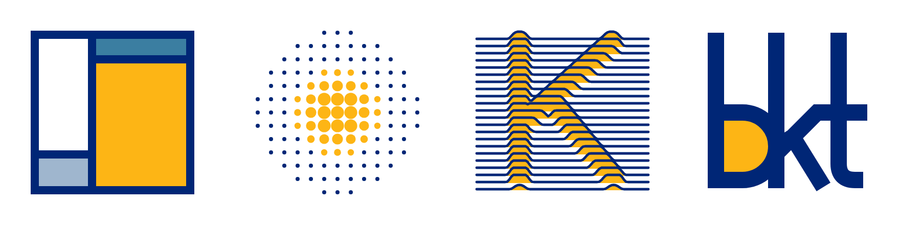
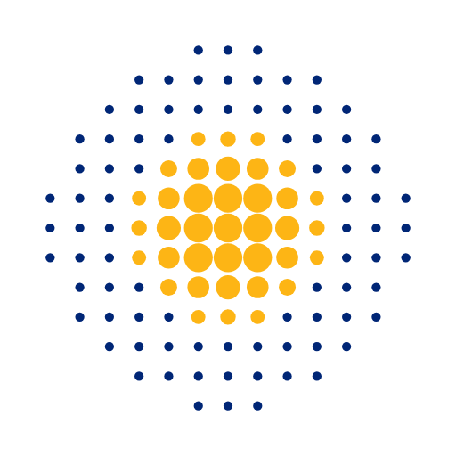
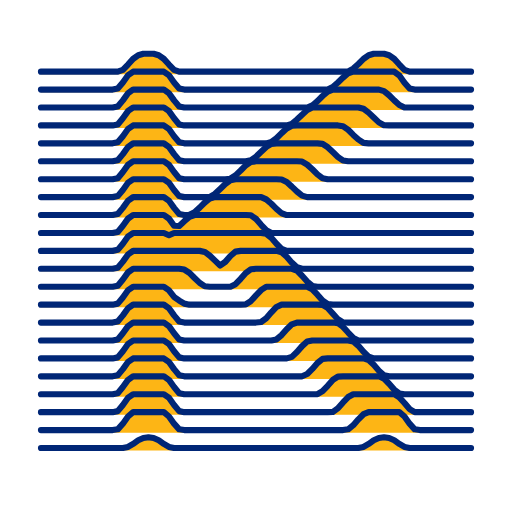

# A logo for pyBKT

pyBKT doesn't have a logo yet. The CAHLR GitHub organization still shows the default avatar, so the project has no mark of its own on GitHub, PyPI or conference slides. This folder has four candidate directions to start that conversation.



## Starting points

- **Berkeley colors.** Every option uses [Berkeley Blue `#002676` and California Gold `#FDB515`](https://brand.berkeley.edu/visual-identity/color/), with Founder's Rock `#3B7EA1` and a light blue `#9FB6CE` as supporting tints. OATutor, the lab's other open-source project, already uses navy and gold, so pyBKT would sit next to it as a sibling.
- **A happy accident with Python.** Python's logo is also blue and yellow. None of these marks use a snake or anything shaped like the Python logo, which keeps clear of the [PSF trademark policy](https://www.python.org/psf/trademarks/) while still feeling at home in the ecosystem.
- **Hidden knowledge, revealed.** BKT infers a hidden knowledge state from observed answers. Each option is a different way of drawing something you can't see directly, showing up through what you can see.
- **Literal to people who know the model.** Someone who knows BKT or graphical models should recognize the math. Everyone else should still see a clean mark.
- **Works alone and small.** Each mark has to hold up as a GitHub avatar, a favicon and a sticker, without the name next to it.

## The options

### A · Emission mosaic


BKT's emission table drawn as a Piet Mondrian composition. The columns are the hidden state (unlearned, learned) and the rows are the observed answer (incorrect, correct). The big gold block is "learned and correct"; the two small cells are **guess** (correct while unlearned) and **slip** (incorrect while learned). The proportions follow illustrative parameter values.

It is the most geometric option and holds up best at 16px.

### B · Halftone latent



Inspired by halftone printing, where an image only appears when you step back and see all the dots together. Each small dot is one observed response; together they resolve into a gold disc, the latent knowledge state. A single answer tells you little, many answers reveal what the learner knows.

### C · Relief K



Inspired by the stacked line plot on Joy Division's *Unknown Pleasures* cover (Peter Saville's design, from Harold Craft's plot of the pulsar CP 1919). Each line is a stream of observations, and it lifts wherever it passes over a hidden **K**, for the Knowledge in BKT. The letter is never drawn; it shows up only through the lines.

This is the most "poster" option and would also work as background art for slides and the docs.

### D · bkt ligature


Inspired by Tolkien's JRRT monogram, where letters share strokes to become one glyph. The b's bowl closes on the k's stem, and the k's arm runs at 45° into the t's crossbar. The gold bowl is the learned state.

It is the only option with letters in it, so it doubles as a wordmark.

## Files

| Option | SVG | PNG (512px) |
| --- | --- | --- |
| A · Emission mosaic | [svg](option-a-emission-mosaic.svg) | [png](png/option-a-emission-mosaic.png) |
| B · Halftone latent | [svg](option-b-halftone-latent.svg) | [png](png/option-b-halftone-latent.png) |
| C · Relief K | [svg](option-c-relief-k.svg) | [png](png/option-c-relief-k.png) |
| D · bkt ligature | [svg](option-d-bkt-ligature.svg) | [png](png/option-d-bkt-ligature.png) |

The SVGs have transparent backgrounds. B and C are computed, so all four are generated by [`build.py`](build.py):

```bash
python docs/logo/build.py
```

## Next steps

Once a direction is picked, the follow-up work is a wordmark lockup ("pyBKT" next to the mark), a reversed version for dark backgrounds, simplified cuts for 16 and 32px, and adding the logo to the README and docs.
